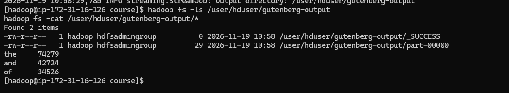

# Hadoop Training Questions

## Exercise 1

### Summary of Runs (Default vs. 6 Reducers)

| Job Counter / Metric | Run 1 (Default) | Run 2 (`-numReduceTasks 6`) |
| :--- | :---: | :---: |
| Launched map tasks | 9 | 9 |
| Launched reduce tasks | 3 | 6 |
| Merged Map outputs | 27 | 54 |
| Output partition files (`part-0000X`) | 3 | 6 |

**Q1. How many files are there?**  
There are **6** output partition files (`part-00000` to `part-00005`), or **7** items in total including the `_SUCCESS` marker file. (In the initial default run, there were 3 partition files / 4 items in total.)

**Q2. Did the number of mappers change?**  
**No.** The number of mappers remained **9** (`Launched map tasks=9`). The `-numReduceTasks` parameter only controls the reduce phase, while the number of mappers is determined by the input splits, which did not change.

**Q3. Did the number of reducers change?**  
**Yes.** The number of reducers increased from **3** (the default) to **6** (`Launched reduce tasks=6`) because we explicitly specified `-numReduceTasks 6`.

**Q4. Did the number of output files change? Why?**  
**Yes**, the number of output partition files increased from **3** to **6**. In MapReduce, each reducer writes its output to its own dedicated partition file (`part-0000X`), so the number of output partition files is always equal to the number of reducers.

**Q5. What does the value of 'Merged Map outputs' represent, and how is it calculated?**  
`Merged Map outputs` represents the total number of map output partitions fetched (shuffled) and merged by all reducers during the shuffle-and-sort phase.  
* **Calculation:** `Number of Mappers × Number of Reducers`
* **Run 1 (Default):** `9 × 3 = 27`
* **Run 2 (6 Reducers):** `9 × 6 = 54`

---

## Exercise 2

**Q1. Is your change in the mapper or in the reducer?**  
In the **mapper** (`mapper_ex2.py`). MapReduce groups and sorts records by key before sending them to the reducer. Stripping trailing commas and dots and converting words to lowercase must happen in the mapper so variants such as `"Hello"`, `"hello,"`, and `"hello."` produce the same key and are counted together.

**Q2. Please provide your code on GitHub**  
See [`mapper_ex2.py`](./mapper_ex2.py) in this repository.

---

## Exercise 3

**Q1. Is your change in the mapper or in the reducer?**  
In the **reducer** (`reducer_ex3.py`). The total count of each word is only known after the reducer aggregates all occurrences of each key. Therefore, sorting the word counts in descending order and returning only the top 3 results must be performed in the reducer (running with `-numReduceTasks 1` so a single global top 3 is produced).

**Q2. Please provide your code on GitHub**  
See [`reducer_ex3.py`](./reducer_ex3.py) in this repository.

**Q3. Output of the MapReduce (`hadoop fs -ls` and `hadoop fs -cat`)**  
Top 3 word counts:
* `the` — 74279
* `and` — 42724
* `of` — 34526

